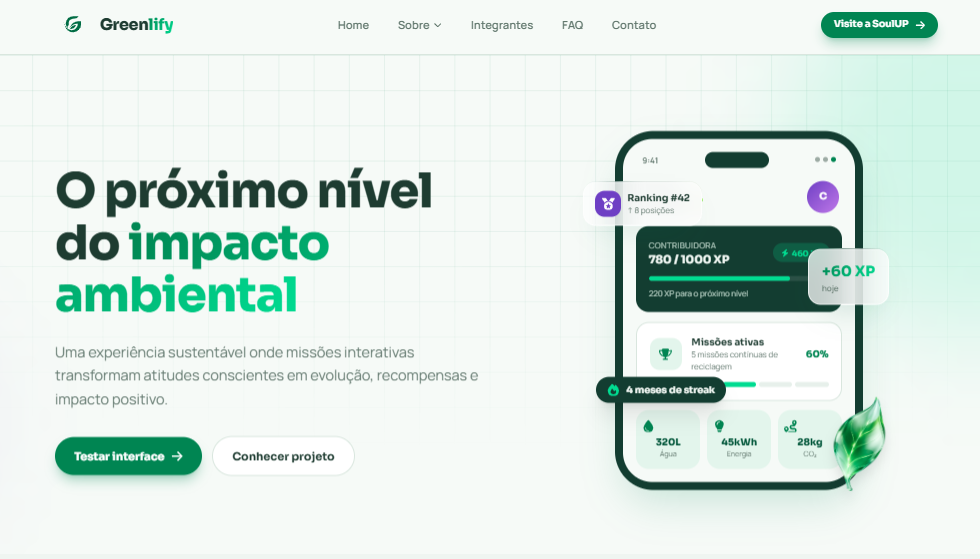
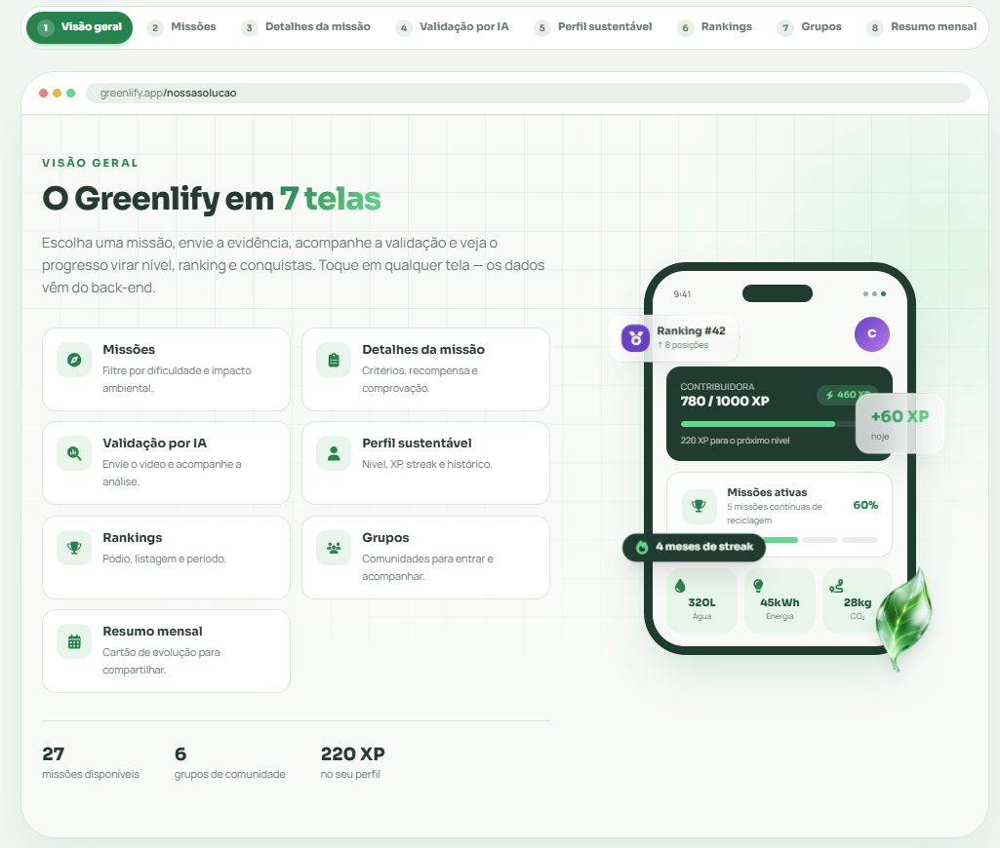
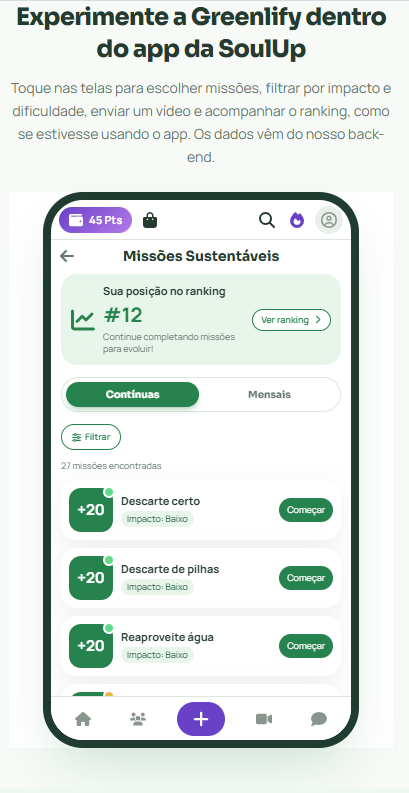
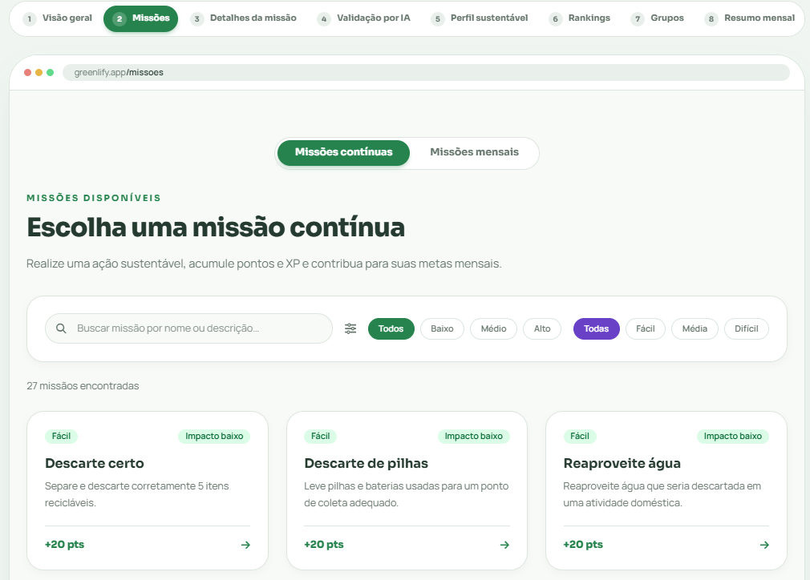
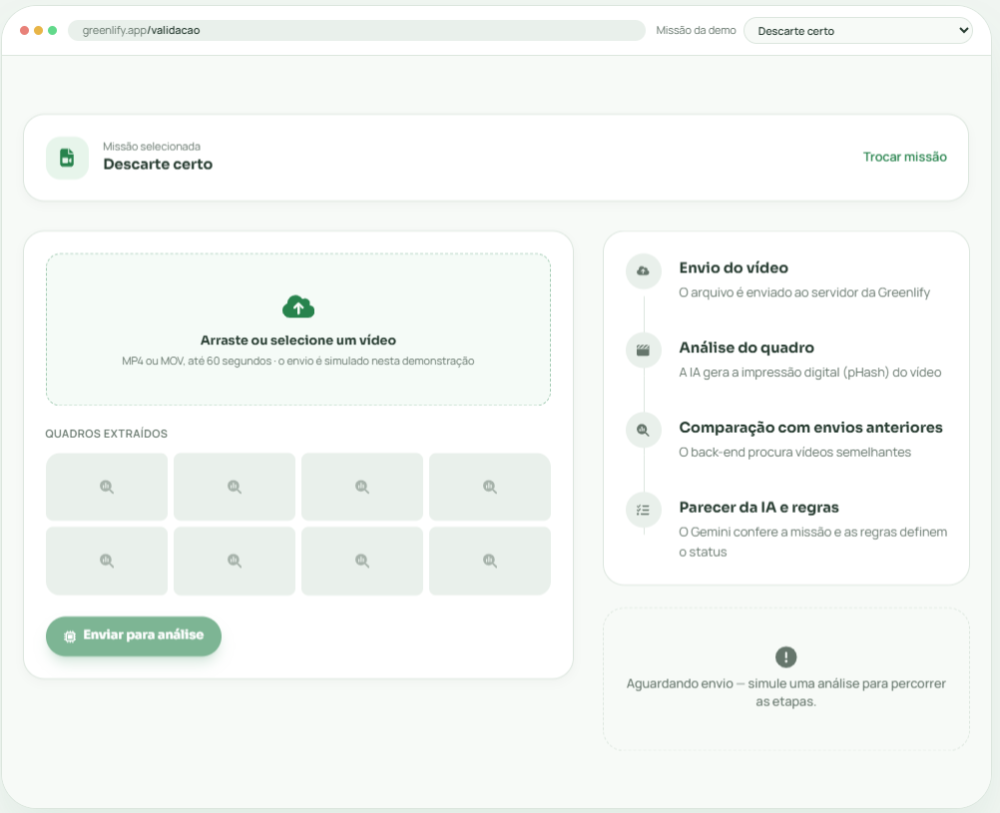
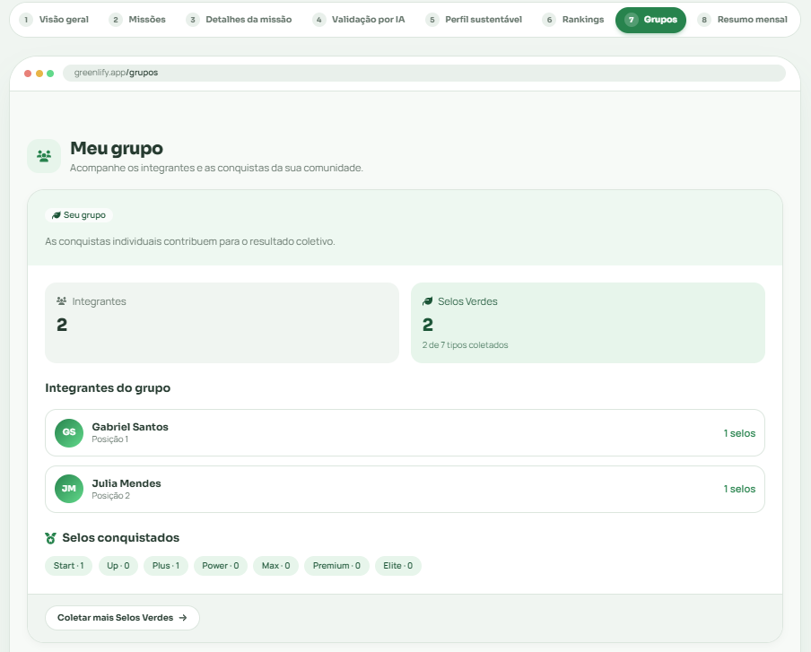
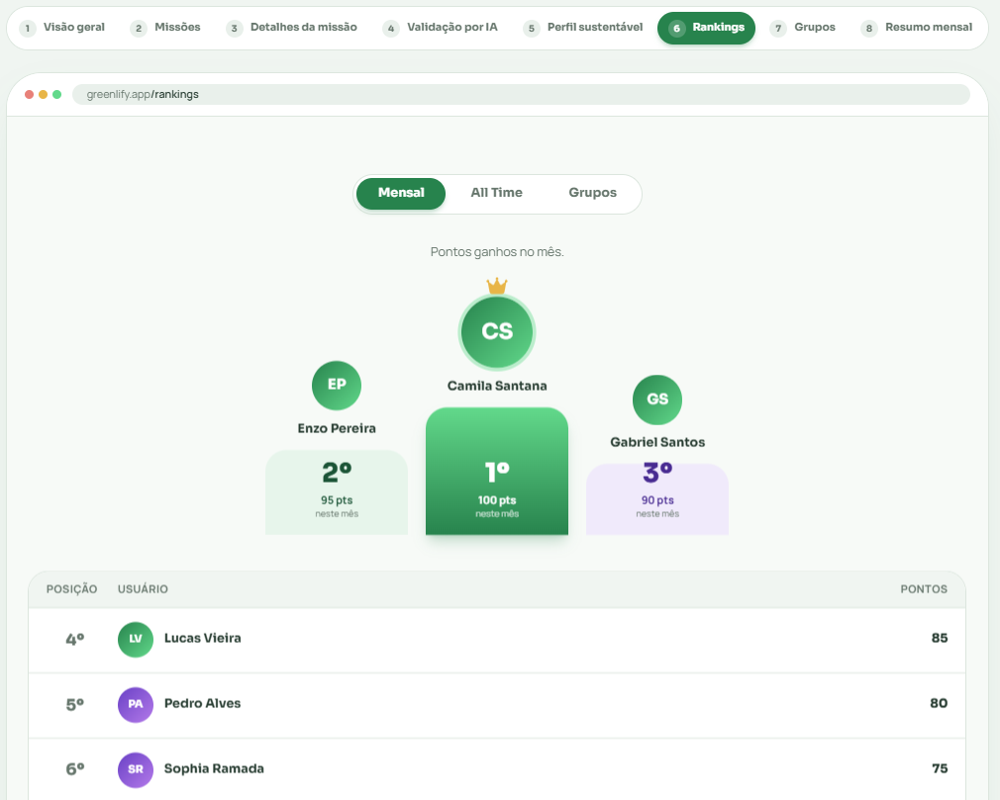
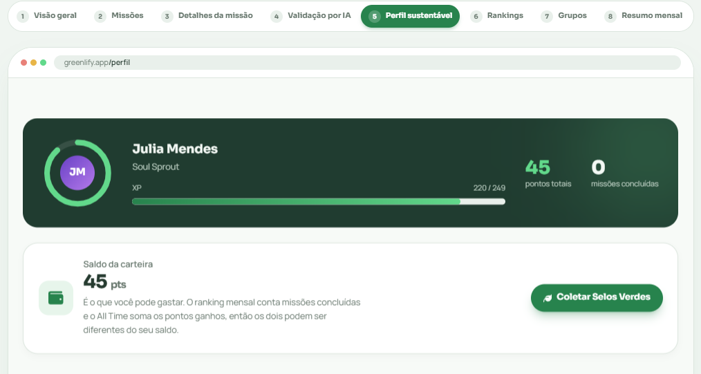
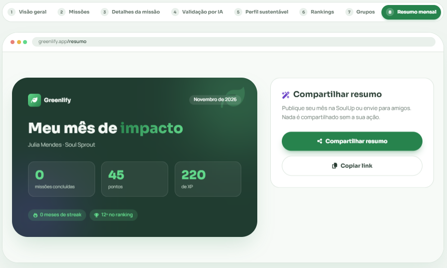

# 🌱 Greenlify
 
<p align="center">
  <strong>Gamificação para incentivar hábitos sustentáveis</strong>
</p>
<p align="center">
  Projeto desenvolvido para a FIAP em parceria com a SoulUp.
</p>

---
 
## 📌 Descrição do Projeto
 
A **Greenlify** é um módulo de gamificação sustentável desenvolvido para a plataforma **SoulUp**.
 
A solução busca incentivar hábitos sustentáveis por meio de **missões, pontuação, rankings e recompensas**, transformando ações sustentáveis em uma experiência mais interativa e motivadora.
 
O usuário pode realizar missões, enviar comprovações das atividades, acumular pontos, acompanhar seu progresso, participar de rankings e conquistar recompensas dentro da plataforma.
 
---
 
## 🛠️ Tecnologias Utilizadas
 
<div align="center">


<br>


<br>


</div>

### Principais tecnologias
 
| Tecnologia | Utilização |
|---|---|
| **React** | Desenvolvimento da interface e criação de componentes reutilizáveis. |
| **TypeScript** | Tipagem dos componentes, propriedades, dados e funcionalidades. |
| **Vite** | Configuração do projeto, desenvolvimento e build da aplicação. |
| **Tailwind CSS** | Estilização da interface e desenvolvimento responsivo. |
| **React Router DOM** | Navegação entre as páginas e gerenciamento de rotas. |
| **React Hook Form** | Gerenciamento e validação dos formulários. |
| **Java** | Desenvolvimento do backend principal e das regras de negócio. |
| **Spring Boot** | Construção da API REST e gerenciamento dos serviços do backend Java. |
| **Python** | Desenvolvimento do serviço auxiliar responsável pelo processamento e validação dos vídeos. |
| **Google Gemini API** | Utilização de inteligência artificial para auxiliar na análise e validação das comprovações em vídeo. |
| **Git** | Controle de versão do projeto. |
| **GitHub** | Hospedagem dos repositórios e colaboração da equipe. |
 
---
 
## ✨ Funcionalidades
 
A Greenlify foi desenvolvida para ampliar o engajamento dos usuários da SoulUp por meio da gamificação sustentável, conectando ações ambientais a mecanismos de reconhecimento, progressão e participação coletiva.
 
<table>
  <tr>
    <td align="center">🌱</td>
    <td>
      <strong>Missões Sustentáveis</strong><br>
      Disponibilização de missões contínuas e mensais, organizadas por categorias e acompanhadas de descrição, critérios de comprovação, prazo, impacto ambiental, dificuldade e pontuação.
    </td>
  </tr>
  <tr>
    <td align="center">🔎</td>
    <td>
      <strong>Detalhamento e Filtros de Missões</strong><br>
      Consulta das informações de cada missão e filtragem por categoria, impacto ambiental e nível de dificuldade.
    </td>
  </tr>
  <tr>
    <td align="center">🎥</td>
    <td>
      <strong>Envio de Comprovação em Vídeo</strong><br>
      Envio de vídeos para comprovar a realização das atividades, vinculando cada comprovação ao usuário e à missão correspondente.
    </td>
  </tr>
  <tr>
    <td align="center">🤖</td>
    <td>
      <strong>Validação com Inteligência Artificial</strong><br>
      Integração de um serviço desenvolvido em Python com a API do Google Gemini para analisar os vídeos enviados e verificar sua correspondência com os critérios das missões. <em>Por utilizar a versão gratuita da API, o serviço pode apresentar falhas em períodos de alta demanda.</em>
    </td>
  </tr>
  <tr>
    <td align="center">🔐</td>
    <td>
      <strong>Fingerprint e Prevenção de Fraudes</strong><br>
      Combinação de SHA-256, pHash e embeddings para identificar arquivos duplicados e conteúdos visualmente semelhantes, dificultando a reutilização de vídeos para obtenção indevida de pontos.
    </td>
  </tr>
  <tr>
    <td align="center">🏆</td>
    <td>
      <strong>Pontuação por Impacto Ambiental</strong><br>
      Atribuição de pontos conforme o impacto ambiental das missões, considerando critérios de pontuação previamente definidos.
    </td>
  </tr>
  <tr>
    <td align="center">⭐</td>
    <td>
      <strong>XP e Nível de Contribuição</strong><br>
      Sistema de progressão que representa a experiência acumulada e a evolução do usuário de acordo com sua participação nas atividades sustentáveis.
    </td>
  </tr>
  <tr>
    <td align="center">🏅</td>
    <td>
      <strong>Rankings</strong><br>
      Rankings mensais e gerais (All Time), além de rankings de grupos, permitindo acompanhar o desempenho individual e coletivo.
    </td>
  </tr>
  <tr>
    <td align="center">👥</td>
    <td>
      <strong>Grupos e Engajamento Coletivo</strong><br>
      Participação em grupos e acompanhamento do desempenho coletivo, com posições determinadas pelos Selos Verdes resgatados pelos integrantes.
    </td>
  </tr>
  <tr>
    <td align="center">💰</td>
    <td>
      <strong>Recompensas e Selos Verdes</strong><br>
      Reconhecimento das conquistas por meio de Selos Verdes e integração com benefícios do ecossistema SoulUp, como vales de energia e compensações de carbono.
    </td>
  </tr>
  <tr>
    <td align="center">🔥</td>
    <td>
      <strong>Streak de Participação</strong><br>
      Acompanhamento da recorrência das atividades sustentáveis, incentivando a continuidade da participação dos usuários.
    </td>
  </tr>
  <tr>
    <td align="center">👤</td>
    <td>
      <strong>Perfil Sustentável</strong><br>
      Reunião de informações sobre a evolução do usuário, incluindo participação, conquistas, pontos, XP e nível de contribuição.
    </td>
  </tr>
  <tr>
    <td align="center">📊</td>
    <td>
      <strong>Desempenho Mensal</strong><br>
      Resumo dos resultados obtidos durante o mês, permitindo acompanhar a participação, as missões concluídas e as conquistas alcançadas.
    </td>
  </tr>
  <tr>
    <td align="center">📤</td>
    <td>
      <strong>Compartilhamento de Conquistas</strong><br>
      Possibilidade de compartilhar resultados e conquistas nas redes sociais, ampliando a visibilidade das ações sustentáveis e da SoulUp.
    </td>
  </tr>
  <tr>
    <td align="center">🔗</td>
    <td>
      <strong>Integração entre Serviços</strong><br>
      Comunicação entre o backend principal em Java com Spring Boot e o serviço auxiliar em Python, responsável pelo processamento e pela validação inteligente dos vídeos.
    </td>
  </tr>
</table>

> [!WARNING]
> **Aviso sobre a validação por IA**
>
> O serviço em Python responsável pela validação dos vídeos utiliza a **versão gratuita** da API do Google Gemini e está hospedado em um plano gratuito. Por isso, a validação pode **falhar ou demorar** em momentos de **alta demanda** ou limite de requisições.
>
> Caso isso aconteça, aguarde alguns instantes e tente enviar o vídeo novamente. A primeira requisição após um período de inatividade também pode ser mais lenta, pois os servidores gratuitos precisam "acordar".
 
## 📁 Estrutura de Pastas do Projeto
 
A estrutura do projeto foi organizada de forma a separar as páginas, componentes reutilizáveis, imagens e arquivos de configuração da aplicação.
 
```text
greenlify-front-s4/
├── exemplos/
│   ├── reciclagem.mp4
│   └── missao-x.mp4
├── src/
│   ├── assets/
│   │   ├── img/
│   │   │   ├── home/
│   │   │   │   └── hero-leaf.png
│   │   │   ├── integrantes/
│   │   │   │   ├── img-camila.jpeg
│   │   │   │   ├── img-enzo.jpeg
│   │   │   │   ├── img-lucas.jpeg
│   │   │   │   └── img-sophia.jpeg
│   │   │   ├── logo/
│   │   │   │   └── logoGreenlify.svg
│   │   │   └── sobre/
│   │   │       ├── img-fiap.jpeg
│   │   │       └── img-soulup.png
│   │   └── .gitkeep
│   ├── components/
│   │   ├── layout/
│   │   │   ├── CtaBanner/
│   │   │   ├── Footer/
│   │   │   ├── Grid/
│   │   │   ├── Header/
│   │   │   ├── Hero/
│   │   │   ├── Logo/
│   │   │   ├── Menu/
│   │   │   ├── Reveal/
│   │   │   ├── Section/
│   │   │   └── SectionHeading/
│   │   └── ui/
│   │       ├── Badge/
│   │       ├── Button/
│   │       ├── Card/
│   │       ├── Chart/
│   │       ├── Dashboard/
│   │       ├── FAQCard/
│   │       ├── FeatureCard/
│   │       ├── Feedback/
│   │       ├── Field/
│   │       ├── Forms/
│   │       ├── IconBox/
│   │       ├── ItemList/
│   │       ├── MediaCard/
│   │       ├── Modal/
│   │       ├── Pagination/
│   │       ├── ProgressBar/
│   │       ├── Roadmap/
│   │       ├── Tabs/
│   │       └── Toast/
│   ├── docs/
│   │   └── img/
│   │       ├── home.png
│   │       ├── missoes.png
│   │       └── perfil.png
│   ├── features/
│   │   ├── badges/
│   │   │   ├── components/
│   │   │   │   ├── Badge/
│   │   │   │   ├── CarteiraCard/
│   │   │   │   └── ColetarSelos/
│   │   │   ├── hooks/
│   │   │   │   └── useBadges.ts
│   │   │   ├── services/
│   │   │   │   └── badgeService.ts
│   │   │   └── types/
│   │   │       └── badges.ts
│   │   ├── demo/
│   │   │   ├── components/
│   │   │   │   ├── DemoShowcase/
│   │   │   │   ├── PhoneDemo/
│   │   │   │   ├── PhoneGrupos/
│   │   │   │   ├── PhoneMissoes/
│   │   │   │   ├── PhonePerfil/
│   │   │   │   ├── PhoneRanking/
│   │   │   │   ├── PhoneSelos/
│   │   │   │   └── PhoneTabs/
│   │   │   ├── types/
│   │   │   │   └── demo.ts
│   │   │   └── utils/
│   │   │       └── formatar.ts
│   │   ├── groups/
│   │   │   ├── hooks/
│   │   │   │   └── useGroups.ts
│   │   │   ├── services/
│   │   │   │   └── groupService.ts
│   │   │   └── types/
│   │   │       └── group.ts
│   │   ├── missions/
│   │   │   ├── components/
│   │   │   │   ├── FilterBar/
│   │   │   │   ├── MissionCard/
│   │   │   │   ├── MissionFilter/
│   │   │   │   ├── MissionModal/
│   │   │   │   └── Upload/
│   │   │   ├── hooks/
│   │   │   │   ├── useFiltroMissoes.ts
│   │   │   │   └── useMissoes.ts
│   │   │   ├── services/
│   │   │   │   └── missionService.ts
│   │   │   ├── types/
│   │   │   │   └── mission.ts
│   │   │   └── utils/
│   │   │       └── mapMission.ts
│   │   ├── profile/
│   │   │   ├── components/
│   │   │   │   ├── ProfileHeader/
│   │   │   │   └── SummaryCard/
│   │   │   ├── hooks/
│   │   │   │   └── useProfile.ts
│   │   │   ├── services/
│   │   │   │   └── profileService.ts
│   │   │   └── types/
│   │   │       └── profile.ts
│   │   ├── ranking/
│   │   │   ├── components/
│   │   │   │   ├── GroupCard/
│   │   │   │   ├── RankingTable/
│   │   │   │   └── RankingTabs/
│   │   │   ├── hooks/
│   │   │   │   └── useRankings.ts
│   │   │   ├── services/
│   │   │   │   └── rankingService.ts
│   │   │   └── types/
│   │   │       └── ranking.ts
│   │   ├── usuario/
│   │   │   ├── types/
│   │   │   │   └── usuario.ts
│   │   │   └── utils/
│   │   │       └── usuarioAtual.ts
│   │   └── validation/
│   │       ├── components/
│   │       │   ├── AnalysisResult/
│   │       │   └── VideoFrames/
│   │       ├── services/
│   │       │   └── validationService.ts
│   │       └── types/
│   │           └── validation.ts
│   ├── routes/
│   │   ├── Contato/
│   │   ├── Error/
│   │   ├── FAQ/
│   │   ├── Grupos/
│   │   ├── Home/
│   │   ├── Integrantes/
│   │   ├── MissaoDetalhe/
│   │   ├── Missoes/
│   │   ├── NossaSolucao/
│   │   ├── Perfil/
│   │   ├── Rankings/
│   │   ├── Resumo/
│   │   ├── Sobre/
│   │   └── Validacao/
│   ├── shared/
│   │   ├── hooks/
│   │   │   └── useCarregar.ts
│   │   └── services/
│   │       └── api.ts
│   ├── App.tsx
│   ├── global.css
│   └── main.tsx
├── .env.example
├── .gitignore
├── eslint.config.js
├── index.html
├── package-lock.json
├── package.json
├── README.md
├── tsconfig.app.json
├── tsconfig.json
├── tsconfig.node.json
└── vite.config.ts
```

---
 
## 🖼️ Imagens do Projeto
 
A interface do Greenlify foi desenvolvida com uma identidade visual voltada à sustentabilidade, utilizando imagens, ícones e elementos gráficos para tornar a navegação mais intuitiva e apresentar as principais funcionalidades da solução.
 
## 💻 Interfaces do Projeto
 
Algumas das telas da Greenlify, da página inicial à jornada completa do usuário.
 
<table align="center">
  <tr>
    <td align="center" width="33%">
      <br>
      <sub><b>Página inicial</b><br>Apresentação da plataforma</sub>
    </td>
    <td align="center" width="33%">
      <br>
      <sub><b>Visão geral</b><br>Resumo das funcionalidades</sub>
    </td>
    <td align="center" width="33%">
      <br>
      <sub><b>Versão mobile</b><br>Layout responsivo</sub>
    </td>
  </tr>
  <tr>
    <td align="center" width="33%">
      <br>
      <sub><b>Missões</b><br>Desafios contínuos e mensais</sub>
    </td>
    <td align="center" width="33%">
      <br>
      <sub><b>Validação</b><br>Envio e análise do vídeo</sub>
    </td>
    <td align="center" width="33%">
      <br>
      <sub><b>Grupos</b><br>Comunidade e Selos Verdes</sub>
    </td>
  </tr>
  <tr>
    <td align="center" width="33%">
      <br>
      <sub><b>Rankings</b><br>Mensal, grupos e all-time</sub>
    </td>
    <td align="center" width="33%">
      <br>
      <sub><b>Perfil</b><br>Nível, pontos e conquistas</sub>
    </td>
    <td align="center" width="33%">
      <br>
      <sub><b>Resumo</b><br>Impacto para compartilhar</sub>
    </td>
  </tr>
</table>

## 🚀 Como Usar
 
### 🌐 Acessar a aplicação
 
A aplicação Greenlify está hospedada na Vercel e pode ser acessada pelo link:
 
<p align="center">
  <a href="https://greenlify-front-s4.vercel.app/">
    
  </a>
</p>

**URL do projeto:** https://greenlify-front-s4.vercel.app/
 
> [!NOTE]
> O back-end está hospedado em um plano gratuito (Render). A primeira requisição após um período de inatividade pode demorar alguns segundos para responder.
 
### 📁 Repositório do GitHub
 
O código-fonte do projeto está disponível no GitHub:
 
<p align="center">
  <a href="https://github.com/milasnt/greenlify-front-s4">
    
  </a>
</p>

**Link do repositório:** https://github.com/milasnt/greenlify-front-s4
 
### 🎥 Vídeo de apresentação
 
O vídeo apresenta a proposta da Greenlify, suas principais funcionalidades e o funcionamento da solução.
 
**Link do YouTube:** https://youtu.be/LV1MHgijwXc?si=z2qkj9h78x-hI68q
 
### 🎬 Vídeos para teste
 
Para facilitar a avaliação da validação por IA, disponibilizamos vídeos de exemplo:
 
| Missão | Vídeo |
|---|---|
| Plante uma árvore nativa | [📥 Baixar](./exemplo/plantando-arvore.mp4)
 
> Envie o vídeo na missão indicada na tabela. Cada vídeo só pode ser usado uma vez, pois o sistema bloqueia duplicatas (SHA-256 e pHash). Além disso, a validação pode falhar em momentos de alta demanda (veja o aviso na seção [Funcionalidades](#-funcionalidades)).
 
### 💻 Executar localmente
 
#### Pré-requisitos
 
Para executar o projeto localmente, é necessário ter instalado:
 
- [Node.js](https://nodejs.org/)
- npm (gerenciador de pacotes do Node.js)
- [Git](https://git-scm.com/)
#### 1. Clonar o repositório
 
Abra o terminal e execute:
 
```bash
git clone https://github.com/milasnt/greenlify-front-s4.git
```
 
#### 2. Acessar a pasta do projeto
 
```bash
cd greenlify-front-s4
```
 
#### 3. Instalar as dependências
 
```bash
npm install
```
 
#### 4. Configurar as variáveis de ambiente
 
Crie um arquivo `.env` na raiz do projeto e configure a URL da API utilizada pela aplicação:
 
```env
VITE_API_URL=https://greenlify-s4.onrender.com
```
 
- `VITE_API_URL`: endereço do back-end principal, desenvolvido em Java.
> [!NOTE]
> Por estar em um plano gratuito, o back-end pode levar alguns segundos para responder na primeira chamada.
 
#### 5. Executar a aplicação
 
Após instalar as dependências e configurar as variáveis de ambiente, execute:
 
```bash
npm run dev
```
 
O Vite disponibilizará um endereço local no terminal. Acesse pelo navegador, normalmente:
 
```text
http://localhost:5173
```
 
## 👨‍💻 Autores e Créditos
 
<table>
  <tr>
    <th>Integrante</th>
    <th>RM</th>
    <th>Turma</th>
    <th>LinkedIn</th>
    <th>GitHub</th>
  </tr>
  <tr>
    <td>Camila Souza Santana</td>
    <td>RM573993</td>
    <td>1TDSPJ</td>
    <td>
      <a href="https://www.linkedin.com/in/camila-souza-52164a3a5/">
        LinkedIn
      </a>
    </td>
    <td>
      <a href="https://github.com/milasnt">
        GitHub
      </a>
    </td>
  </tr>
  <tr>
    <td>Enzo Gabriel Florencio Pereira</td>
    <td>RM573898</td>
    <td>1TDSPK</td>
    <td>
      <a href="https://www.linkedin.com/in/enzo-pereira-931a323a6/">
        LinkedIn
      </a>
    </td>
    <td>
      <a href="https://github.com/EnzoPereira0618">
        GitHub
      </a>
    </td>
  </tr>
  <tr>
    <td>Lucas Marti Zapater Vieira</td>
    <td>RM571053</td>
    <td>1TDSPJ</td>
    <td>
      <a href="https://www.linkedin.com/in/lucas-marti-zapater-vieira-b902a4236/">
        LinkedIn
      </a>
    </td>
    <td>
      <a href="https://github.com/Lucasvieira-tech">
        GitHub
      </a>
    </td>
  </tr>
  <tr>
    <td>Sophia Teixeira Ramada</td>
    <td>RM573823</td>
    <td>1TDSPJ</td>
    <td>
      <a href="https://www.linkedin.com/in/sophia-ramada-228b07364/">
        LinkedIn
      </a>
    </td>
    <td>
      <a href="https://github.com/sophRmd">
        GitHub
      </a>
    </td>
  </tr>
</table>
---
 
## 🔗 Links
 
### 📁 Repositório do GitHub
 
<p>
  <a href="https://github.com/milasnt/greenlify-front-s4">
    🔗<strong>Acessar o repositório do projeto</strong>
  </a>
</p>
---
 
## 📞 Contato
 
Para dúvidas, sugestões ou informações sobre o projeto, entre em contato com os integrantes da equipe através dos links disponibilizados na seção **Autores e Créditos**.
 
Também é possível entrar em contato diretamente pelo e-mail:
 
<p align="center">
  📧 <strong>greenlify@gmail.com</strong>
</p>

---
 
<div align="center">
### 🌱 Greenlify
 
<strong>Tecnologia + Gamificação + Sustentabilidade</strong>
Desenvolvido com 💚 para a <strong>FIAP</strong>.
 
</div>
